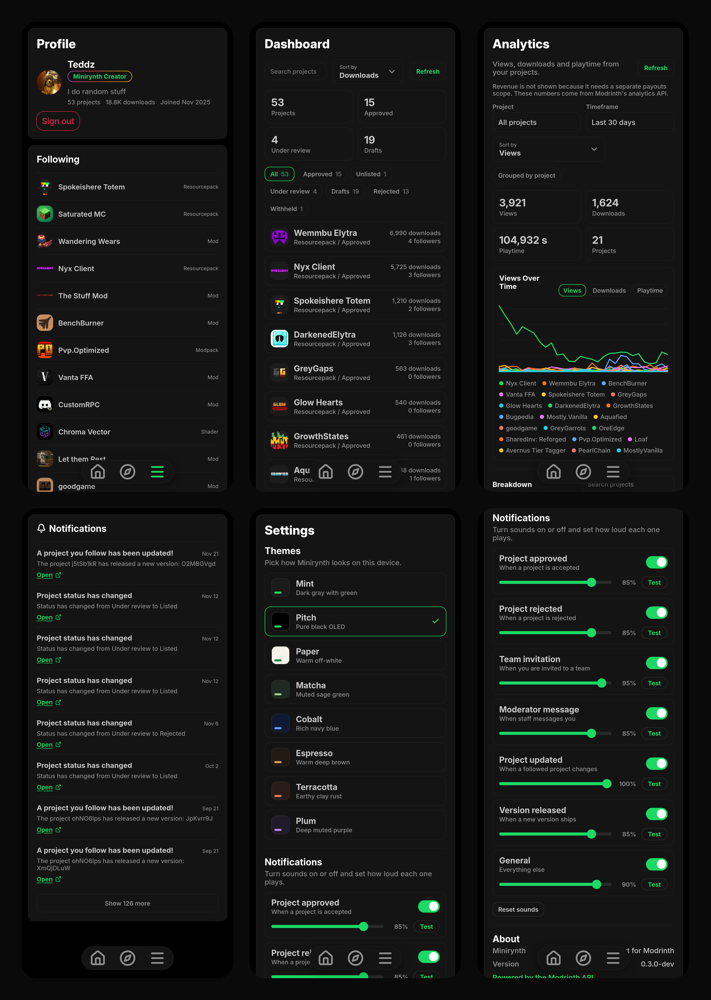

# Minirynth

Formerly Minirinth.

Unofficial mobile port for Modrinth. Browse mods, resource packs, shaders, data packs, modpacks and plugins on your phone. It reads from the public Modrinth API and never installs or launches Minecraft.

Vue 3, TypeScript and Vite, wrapped for Android with Capacitor. Powered by the [Modrinth API](https://modrinth.com), not affiliated with Modrinth.

Current build: v0.2.1-dev.

## Contents

- [What works now](#what-works-now)
- [Coming later](#coming-later)
- [Screenshots](#screenshots)
- [Running it](#running-it)
- [Releases](#releases)
- [Licensing](#licensing)

## What works now

- Browse mods, shaders, resource packs, data packs, modpacks and plugins with real API results.
- Search by title, author, description or slug, then narrow things down with filters, sorting and pagination.
- Open a project to see its description, tags, versions, gallery and external links.
- Project pages use type based links like `/mod/fabric-api` and `/shader/sodium`.
- Sign in with a Modrinth personal access token to see your profile, published projects, download counts and bio.
- A floating dock that hides when you scroll down and returns when you scroll up.

## Coming later

- Creating projects, uploading versions and editing descriptions.
- Viewing other profiles
- Logging in from Modrinth ([Modrinth API docs](https://docs.modrinth.com/))
- More to come i just don't know what..

## Screenshots

## Running it (for devs)

pnpm install
pnpm dev

For a production web build:

pnpm build

Sync the web build into the Android project:

pnpm cap:sync

The Android project lives in `android/`. A debug build needs JDK 21 and Android SDK Platform 36 with Build Tools 35. Set `sdk.dir` in `android/local.properties` if Android Studio is not managing it for you.

## Releases

Prebuilt Android APKs are on the [releases page](https://github.com/frteddz/Minirynth/releases).

## Licensing

GPLv3, see [LICENSE](LICENSE). Base styles and components copied from the Modrinth monorepo live in `src/ui/` and stay GPLv3. See `src/ui/COPYING.md` for what was copied and what was left out. No Modrinth logo or wordmark is used. The logo and green accent come from the Minirynth pack in `assets/minirynth-logos/`.

Credits:

- Lucide, ISC license, for the compass needle shape in the logo.
- Inter, SIL Open Font License, see `src/assets/fonts/OFL.txt`.
- Simple Icons, CC0 1.0, for a few filler icons.
- Modrinth API tag icons for loaders and categories.
- Notification sounds from Freesound by Kagateni, heyheytheree, zenosounds, SelectDetail57, yfjesse and Graham Makes, listed in `assets/notification-sfx/CREDITS.md`.
