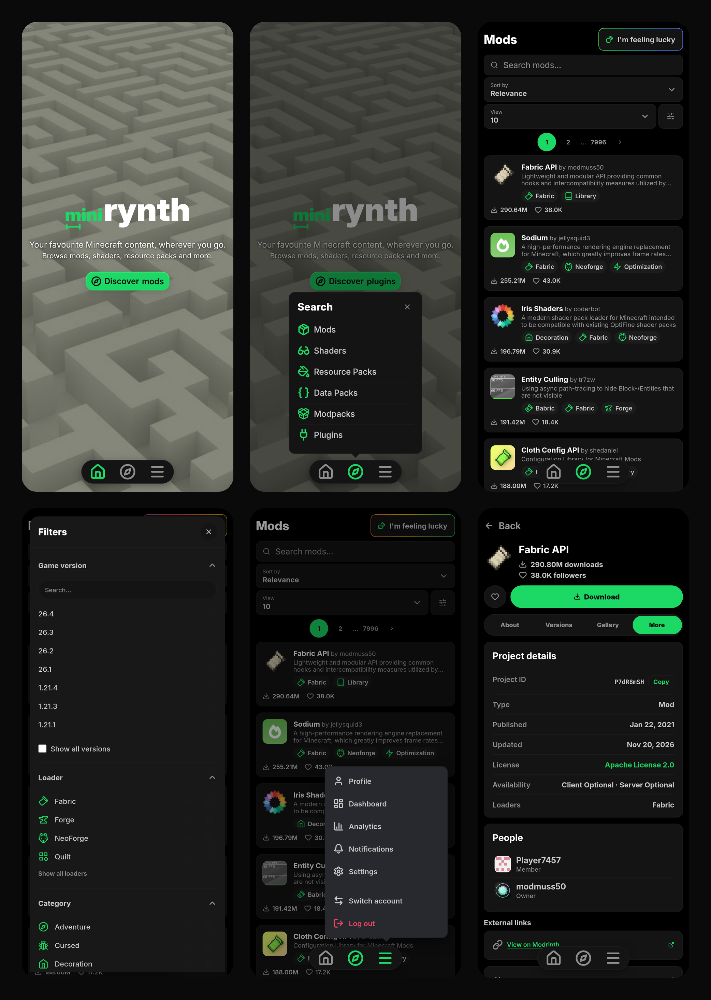

# Minirynth

Formerly Minirinth.

Unofficial mobile port for Modrinth. Browse mods, resource packs, shaders, data packs, modpacks and plugins on your phone. It reads from the public Modrinth API and never installs or launches Minecraft.

Vue 3, TypeScript and Vite, wrapped for Android with Capacitor. Powered by the [Modrinth API](https://modrinth.com), not affiliated with Modrinth.

Current build: v0.4.7-dev.

## Contents

- [What works now](#what-works-now)
- [Coming soon](#coming-soon)
- [Screenshots](#screenshots)
- [Running it](#running-it)
- [Releases](#releases)
- [Links](#links)
- [Licensing](#licensing)

## What works now

- Browse mods, shaders, resource packs, data packs, modpacks and plugins with real API results, plus a Feeling Lucky button.
- Search by title, author, description or slug, then narrow things down with filters, sorting and pagination.
- Open a project to see its description, tags, versions, gallery and external links. The gallery viewer supports swiping, next and previous, captions and image downloads.
- Project pages use type based links like `/mod/fabric-api` and `/shader/sodium`.
- Sign in with your Modrinth account through OAuth. A personal access token still works as a fallback, and you can save a few accounts and switch between them without signing out.
- See your profile, published projects, download counts and bio.
- Follow projects and read your notifications on their own page. Notifications can pop up with custom sounds even while the app is in the background.
- Creator tools: a dashboard and analytics with download and follower stats.
- Create, edit and delete projects. Edit descriptions, tags, license, links, icons and gallery images.
- Upload, edit and delete versions, including extra files and dependencies.
- Join, leave, create and edit organizations. Manage members, roles, ownership and project transfers.
- Open public user profiles from project pages and project member lists.
- Eight themes and per-sound notification volume controls.
- A floating dock that hides when you scroll down and returns when you scroll up.

## Coming soon

- Adding mods, resource packs, data packs, and so on to your Modrinth instance from Minirynth where ever you are. for example: you are having a vacation on a beach in Hawaii and for a random reason a thought popped in your head that you wanna add a mod to your Modrinth instance but you can't since your miles away from your pc, so you download Minirynth and just by a couple clicks of a button (i hope so) the mod is automatically added to your Modrinth instance. soo yea.. this one will be big and difficult (as far as i know), so this will be later on. (There is no specific date for this yet)
- Working with mobile Minecraft launchers like Mojo, so Minirynth can add things straight to the instance you actually play on. I want to support as many mobile launchers as I can, but I'm not promising a specific list or date yet.
- Managing servers from your phone. Adding mods, updating packs and keeping everything in sync while you are away from your pc. This is the one I want most, honestly.
- Scheduling releases, collections, content disclosures and payouts.
- More to come i just don't know what..

## Screenshots

## Running it (for devs)

pnpm install
pnpm dev

For a production web build:

pnpm build

Sync the web build into the Android project:

pnpm cap:sync

The Android project lives in `android/`. A debug build needs JDK 21 and Android SDK Platform 36 with Build Tools 35. Set `sdk.dir` in `android/local.properties` if Android Studio is not managing it for you.

## Releases

Prebuilt Android APKs are on the [releases page](https://github.com/frteddz/Minirynth/releases).

## Links

 **Minirynth is built by a single developer. if you’d like to support the project, you can [donate here](https://ko-fi.com/majdsafi).**

## Licensing

GPLv3, see [LICENSE](LICENSE). Base styles and components copied from the Modrinth monorepo live in `src/ui/` and stay GPLv3. See `src/ui/COPYING.md` for what was copied and what was left out. No Modrinth logo or wordmark is used. The logo and green accent come from the Minirynth pack in `assets/minirynth/`.

Credits:

- Lucide, ISC license, for the compass needle shape in the logo.
- Inter, SIL Open Font License, see `src/assets/fonts/OFL.txt`.
- Simple Icons, CC0 1.0, for a few filler icons.
- Modrinth API tag icons for loaders and categories.
- Notification sounds from Freesound by Kagateni, heyheytheree, zenosounds, SelectDetail57, yfjesse and Graham Makes, listed in `assets/notification-sfx/CREDITS.md`.
